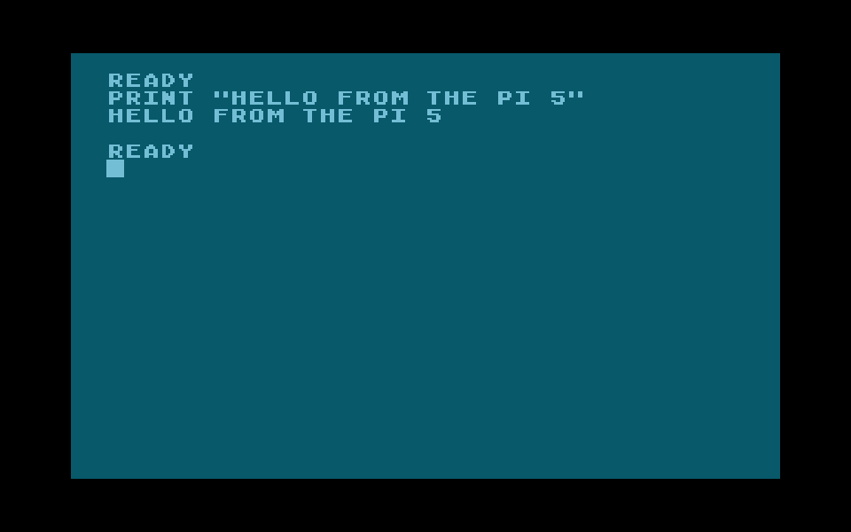
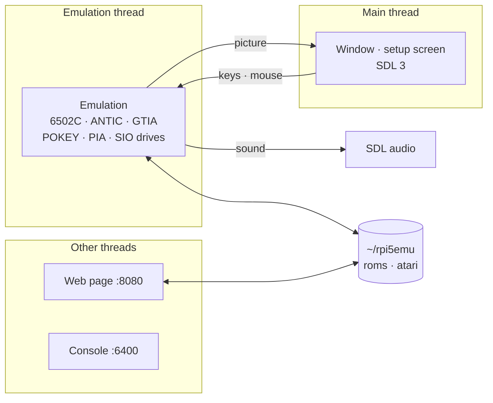

<h1 align="center">rpi5xl</h1>

<p align="center">
  <b>An Atari 800XL or 130XE on the Raspberry Pi 5, in a window of its own.</b><br>
  6502C with ANTIC's DMA to the cycle, GTIA with all its modes, POKEY sound, disk drives D1: and D2: with ATR and XFD images.
</p>

<p align="center">
  
  
  
  
  
</p>

<p align="center">
  <b>Work in progress:</b> not everything has been tested, and games and demos may or may not
  work satisfactorily.
</p>

<p align="center">
  
  
  <br>
  <sub>Atari BASIC on the 800XL and on the 130XE, on the Pi.</sub>
</p>

rpi5xl runs [esp32xl](https://github.com/rlucencic/esp32xl)'s Atari on a Raspberry Pi 5 with
64-bit Linux, in a window of its own (X11 or Wayland, through SDL 3). The machine is the
same code as on the ESP32 boards: esp32xl's platform-independent core and
[esp32emu](https://github.com/rlucencic/esp32emu)'s CPU core, on
[rpi5emu](https://github.com/rlucencic/rpi5emu), the family's Linux runtime: a setup
screen in the window, sound, the Pi's keyboard and mouse, a web page on your network and a
console.

It's one of the rpi5 family, the Raspberry Pi versions of the esp32 emulators:
[rpi5zx](https://github.com/rlucencic/rpi5zx) (ZX Spectrum),
[rpi5cpc](https://github.com/rlucencic/rpi5cpc) (Amstrad CPC),
[rpi5cbm](https://github.com/rlucencic/rpi5cbm) (Commodore 64 and 128),
[rpi5coco](https://github.com/rlucencic/rpi5coco) (Tandy Color Computer 2 and 3),
[rpi5gs](https://github.com/rlucencic/rpi5gs) (Apple IIGS),
[rpi5msx](https://github.com/rlucencic/rpi5msx) (MSX1 and MSX2),
[rpi5ste](https://github.com/rlucencic/rpi5ste) (Atari STE),
[rpi5pc](https://github.com/rlucencic/rpi5pc) (IBM PC/XT and PC/AT),
[rpi5mac](https://github.com/rlucencic/rpi5mac) (Macintosh Plus, SE, Classic),
[rpi5mac2](https://github.com/rlucencic/rpi5mac2) (Macintosh LC and II),
[rpi5mac3](https://github.com/rlucencic/rpi5mac3) (Macintosh LC II and LC III),
[rpi5arc](https://github.com/rlucencic/rpi5arc) (Acorn Archimedes),
[rpi5ami](https://github.com/rlucencic/rpi5ami) (Amiga 500, 2000, 600, 1200).

## Features

**The machines**
- **Atari 800XL** (64 KB) and **130XE** (128 KB: four more 16 KB banks at
  `$4000`, for the CPU and ANTIC separately), **PAL or NTSC**, **Atari
  BASIC** on or off, chosen on the setup screen
- **6502C**: every bus cycle as the real CPU does it, on the shared 6502 core
- **ANTIC**: its DMA takes the CPU's cycles where the real one does (display
  list, screen data, characters, players and missiles, memory refresh), and
  WSYNC holds the CPU to the cycle; all text and graphics modes (2 to F),
  horizontal and vertical fine scrolling, narrow, normal and wide
  playfields, display list and vertical blank interrupts
- **GTIA**: players and missiles in all sizes, priority as GTIA's own logic
  (the fifth player, multicolour players), collisions, the GTIA modes 9, 10
  and 11 (16 shades, 9 colours, 16 hues), colour changes in the middle of a
  line timed to the colour clock, PAL and NTSC palettes
- **POKEY**: four sound channels, 8 and 16-bit timers at 64 kHz, 15 kHz or
  1.79 MHz, the 4, 5, 9 and 17-bit noise generators, high-pass filters,
  volume-only mode for samples, timer interrupts, the keyboard, RANDOM, the
  console speaker
- **PIA**: the XL's memory control (OS ROM, BASIC, Self Test, the 130XE's
  banks) and the joystick ports

**Disk drives**
- **D1: and D2:** on the SIO bus, like a 1050 that also does double density:
  status, read, write, format (single and enhanced density) and the PERCOM
  block that DOSes ask for
- **`.ATR`** (128 and 256-byte sectors, whichever way the first three sectors
  are stored) and **`.XFD`** images; writes go back into the image file
- **Fast**: the OS's disk calls are served straight from its device control
  block. Programs that work POKEY's serial port themselves still find the
  whole bus, byte by byte at 19,200 baud
- **New blank disks**: 90 KB single, 130 KB enhanced (1050) or 180 KB double
  density, ready for DOS to format

**Around it**
- **A window** of its own on the Pi's desktop (X11 or Wayland), resizable, full screen
  with Ctrl+Alt+F; the picture in the machine's shape, sharp pixels
- **Setup screen** in the window, first thing at start and any time with Ctrl+Alt+M:
  model, TV, BASIC, the sound's volume, the drives and their images (insert, eject, new
  blank ones), Start / Back / Restart, Reset
- **The Pi's keyboard and mouse**: keys by position, as the boards' Bluetooth keyboards;
  a click in the window gives the mouse to the machine, Ctrl+Alt+G takes it back
- **Web page** at `http://<the Pi>:8080/`: drop images (or ZIP files) onto it, insert
  them, make blank ones, and watch the machine and its drives live
- **Sound** through SDL (PipeWire, PulseAudio or ALSA), the machine paced by the clock
- **Console** on the terminal and on `127.0.0.1:6400`: keys, typing, drives, screenshots

<p align="center">
  
  <br><sub>The setup screen in the window, before the Atari starts</sub>
</p>

## Getting started

### 1. What you need

- A Raspberry Pi 5 with 64-bit Linux (developed on Ubuntu 26.04; any Linux with SDL 3.2 or
  later should do)
- The tools and libraries:
  `sudo apt install build-essential cmake ninja-build pkg-config libsdl3-dev libsdl3-ttf-dev libpng-dev`
- [esp32emu](https://github.com/rlucencic/esp32emu), [rpi5emu](https://github.com/rlucencic/rpi5emu)
  and [esp32xl](https://github.com/rlucencic/esp32xl), cloned next to this project
- The ROMs (below)

### 2. Build

```sh
git clone https://github.com/rlucencic/esp32emu.git
git clone https://github.com/rlucencic/rpi5emu.git
git clone https://github.com/rlucencic/esp32xl.git
git clone https://github.com/rlucencic/rpi5xl.git && cd rpi5xl
cmake -S . -B build -G Ninja && cmake --build build
```

### 3. ROMs

In the data folder's `roms/` (`~/rpi5emu/roms`), named as esp32xl's:
`atarixl.rom` (the XL/XE OS, 16 KB) and `ataribas.rom` (BASIC, 8 KB). Not
part of this repository.

### 4. First start

1. `build/rpi5xl`: the setup screen opens in a window.
2. Choose the model and click **Start**.
3. Put images into `~/rpi5emu/atari/`, drop them on the window or the web page, and
   insert them on the setup screen's **Disks** page.

## Using it

| To | Do |
|---|---|
| Get back to the setup screen | Ctrl+Alt+M (the machine waits meanwhile) |
| Full screen | Ctrl+Alt+F |
| Give the mouse to the machine, take it back | A click in the window; Ctrl+Alt+G |
| Run as fast as it goes (warp) | Ctrl+Alt+W, again for real speed |
| Take a screenshot | Ctrl+Alt+S (into `~/rpi5emu/screenshots`), or the console's `s` |
| Insert an image | The setup screen's **Disks** page, drop it on the window or the web page, or name it on the command line: `build/rpi5xl dos25.atr` |
| Start straight into the machine | `build/rpi5xl -S`, with the setup screen's rows as `--choice`: `build/rpi5xl -S --choice Model=130XE` |
| Show the window on another computer | Log in with `ssh -C -Y <the Pi>` and start it there: fine for still pictures; games want the Pi's own monitor |
| Use DOS 2.5 | Boot its disk; **A** and Return lists the directory, **L** loads a binary file, **B** goes to BASIC |
| Load a BASIC program | `RUN "D:NAME.BAS"` (or `LOAD`, `ENTER` for listings) |
| Self Test | `BYE` in BASIC, or start with BASIC off and no disk |

Images live in `~/rpi5emu/atari/`, settings in `~/.config/rpi5emu/settings.ini`; the
inserted images are remembered across starts. `build/rpi5xl --help` lists the options.

**Keyboard**: letters by position; digits and symbols by the character they
give on a US keyboard, with SHIFT as the Atari needs it (Shift+' is ", which
is Shift+2 on the Atari). Return, Esc, Tab, Backspace (DELETE BACK S), Caps
Lock (CAPS) and Ctrl as themselves; Delete is Ctrl+DELETE, Insert
Ctrl+INSERT, Home CLEAR, `` ` `` and End the inverse (Atari) key; the cursor
keys are Ctrl with `-` `=` `+` `*`. F1 HELP, F2 START, F3 SELECT, F4 OPTION,
F5 RESET, F7 or Pause BREAK.

**Joystick**: the numeric keypad (8 4 6 2 and the diagonals, 0 or 5 fire) in
port 1; F11 switches it to port 2. F12 makes the cursor keys the joystick as
well, with Alt as fire.

## How it works



- **[esp32xl](https://github.com/rlucencic/esp32xl)'s `components/atari_xl`**: the Atari,
  platform independent: the same code runs on the ESP32 boards.
- **`src/`**: the glue, esp32xl's `main/main.c` ported: memory, ROMs, settings, keyboard map,
  drives and status.
- **[rpi5emu](https://github.com/rlucencic/rpi5emu)**: the window, the setup screen, sound,
  input, the web page, the console, the data folder and the settings.
- **[esp32emu](https://github.com/rlucencic/esp32emu)**: the CPU core (6502C).

## Development

```sh
../rpi5emu/tools/pi.sh rpi5xl build        # from another computer: sync to the Pi, build there
../rpi5emu/tools/pi.sh rpi5xl run          # its window on this computer (ssh -C -Y)
../rpi5emu/tools/pi.sh rpi5xl headless     # no window: drive it through the console
../rpi5emu/tools/console.sh i 's /tmp/shot.png'
```

`CLAUDE.md` has the details: the layout, how it was ported, the checks; esp32xl's own
`CLAUDE.md` has the machine's.

## Limitations

- Checked on the Pi through its console and screenshots: the 800XL and 130XE at full speed, BASIC; a blank disk made. Not yet by hand
  in the window, with the sound heard, or with much software.
- Over X forwarding (`ssh -Y`) every changed picture crosses the network: 8 to 15 a second.
- Tested so far with BASIC, the Self Test, Atari DOS 2.5 (formatting and
  copying too), MyDOS 4.50 in double density, the 130XE's banks and a few
  graphics demos; **games haven't been tried yet**.
- No cartridges, `.XEX` or `.CAS` files, no copy-protected disk images
  (`.ATX`, `.PRO`); no cassette, printer or 850 interface.
- ANTIC reads its registers as a line begins: a change in the middle of a
  line (a new character set, scrolling) shows from the next line. NTSC
  colour artefacts in high resolution aren't shown.
- Disks are faster than a real 1050: the drive answers at once, with no
  waiting for the disk to turn.

## Credits

- Avery Lee's [Altirra Hardware Reference Manual](https://www.virtualdub.org/altirra.html):
  the reference for ANTIC's DMA timing, GTIA's priority logic, POKEY, the SIO
  protocol and the disk drives
- Klaus Dormann's 6502 functional tests
- [SDL](https://libsdl.org) 3 for the window, the sound and the input

## Licence

[MIT](LICENSE).

Atari, 800XL and 130XE are trademarks of their owners. The ROM images are not
part of this repository.
